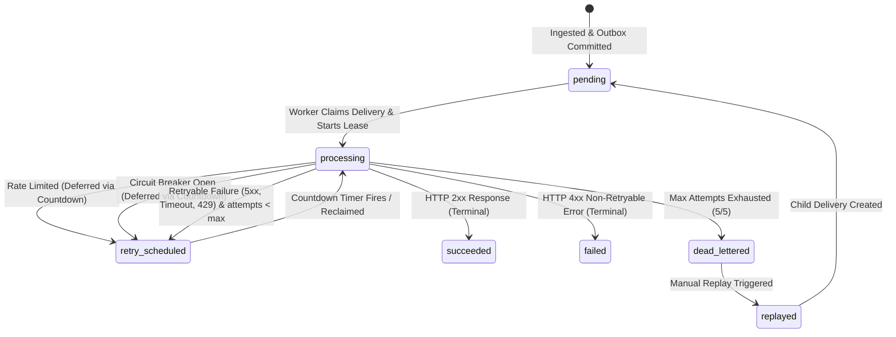

# Reliable Webhook Delivery Platform

[](https://www.python.org/)
[](https://fastapi.tiangolo.com/)
[](https://www.postgresql.org/)
[](https://redis.io/)
[](https://docs.celeryq.dev/)
[](https://www.docker.com/)
[](https://prometheus.io/)
[](https://grafana.com/)
[]()

A production-grade, fault-tolerant, distributed webhook delivery engine designed for multi-tenant SaaS applications. Guarantees durable event ingestion, prevents dual-write failures, provides automated worker crash recovery with a 30-second processing lease watchdog, protects downstream systems with distributed rate limiting and circuit breaking, and offers full end-to-end observability.

**Repository**: [https://github.com/Rishabh-afk-beep/Webhook-project](https://github.com/Rishabh-afk-beep/Webhook-project)

---

## 1. Key Features & Architectural Highlights

- **Zero Event Loss (Transactional Outbox Pattern)**: Ingestion atomically persists events, delivery tasks, and outbox rows in a single PostgreSQL transaction before returning `202 Accepted` to producers.
- **Worker Crash Recovery (30-Second Lease Watchdog)**: If a worker process is terminated (`SIGKILL`, OOM, network cutoff), unacknowledged deliveries are automatically detected and reclaimed after their 30-second lease expires without dropping tasks.
- **Distributed Token Bucket Rate Limiting**: Built with Redis Lua scripting to enforce smooth destination rate limits without fake HTTP attempt records. Excess deliveries are deferred via non-blocking Celery countdowns.
- **Distributed Destination Circuit Breaker**: State machine (`CLOSED` $\to$ `OPEN` $\to$ `HALF_OPEN`) automatically halts traffic to downstream endpoints exhibiting sustained 5xx or connection failures.
- **Exponential Backoff & Full Jitter**: Automated retries for transient HTTP errors (408, 429, 5xx) and connection timeouts with randomized backoff:
  $$\text{delay} = \min\left(\text{max\_delay},\; \text{base\_delay} \times 2^{(\text{attempt} - 1)}\right) \pm \text{jitter}$$
- **Dead-Letter Queue (DLQ) & Non-Destructive Replay**: Deliveries exhausting retries transition to `dead_lettered`. Preserves complete audit history in `delivery_attempts` and supports manual replay via `POST /v1/dead-letters/{id}/replay`.
- **HMAC-SHA256 Cryptographic Signatures**: Every outgoing webhook request includes timestamped `X-Webhook-Signature` headers to prevent tampering and replay attacks.
- **SSRF Defense**: Strict destination URL resolution blocks internal, private, link-local, and loopback IP ranges in production.
- **Full Observability**: Exposes 11 Prometheus metrics, latency quantiles (p50, p90, p95, p99), dynamic queue depth gauges, and includes a pre-provisioned Grafana dashboard.

---

## 2. System Architecture

```mermaid
flowchart TD
    subgraph Ingestion ["1. Event Ingestion (Durable & Decoupled)"]
        Client([Producer Application]) -->|POST /v1/events| API[FastAPI Ingestion Service]
        API -->|In-Memory TTL Cache| AuthCache[API Key Cache]
        API -->|Atomic PostgreSQL Transaction| DB[(PostgreSQL 16)]
        DB -.->|Insert| E[(events)]
        DB -.->|Insert| D[(event_deliveries)]
        DB -.->|Insert| O[(outbox_entries)]
        API -->|202 Accepted| Client
    end

    subgraph Dispatcher ["2. Outbox Dispatcher & Watchdog"]
        OD[Outbox Dispatcher Daemon] -->|SELECT FOR UPDATE SKIP LOCKED| O
        OD -->|Publish Celery Task| RedisQueue[(Redis 7 Broker)]
        OD -->|mark_published_batch| O
        OD -.->|Reclaim Stale Leases > 30s| D
    end

    subgraph DeliveryWorkers ["3. Resilient Delivery Workers"]
        RedisQueue -->|Prefetch Task| Worker[Celery Worker Pool]
        Worker -->|Row Lock & Update Lease| D
        Worker -->|Token Bucket Lua Check| RateLimit[Rate Limiter]
        Worker -->|Failure Ratio Check| CircuitBreaker[Circuit Breaker]
        
        Worker -->|Eligible| HTTPClient[HTTPX Client (HMAC Signed)]
        HTTPClient --> Destination([External Destination Sink])
        Destination -->|HTTP Status / Timeout| HTTPClient
        
        HTTPClient -->|Append Immutable Attempt| AuditLog[(delivery_attempts)]
        HTTPClient -->|Update Terminal or Retry Status| D
        HTTPClient -->|Record Metrics| Prometheus
    end

    subgraph Observability ["4. Observability & DLQ Recovery"]
        Prometheus[(Prometheus 2.54)] -->|Scrape /metrics| API
        Grafana[Grafana 11.2 Dashboard] -->|Query| Prometheus
        Admin([Tenant Operator]) -->|POST /v1/dead-letters/:id/replay| API
    end
```

---

## 3. Delivery State Machine

Every webhook delivery follows a deterministic state machine:



---

## 4. Quickstart: Running with Docker Compose

### Prerequisites
- [Docker Desktop](https://www.docker.com/products/docker-desktop/) (Windows / macOS / Linux)
- [Git](https://git-scm.com/)

### 1. Clone the Repository
```bash
git clone https://github.com/Rishabh-afk-beep/Webhook-project.git
cd Webhook-project
```

### 2. Configure Environment Variables
```bash
cp .env.example .env
```

### 3. Start the Platform
```bash
docker compose up --build -d
```
Spins up the complete 8-service architecture:
- `api`: FastAPI application on `http://localhost:8000`
- `postgres`: PostgreSQL 16 database on `localhost:5432`
- `redis`: Redis 7 broker & state store on `localhost:6379`
- `worker`: Celery worker pool (8 concurrent delivery processes)
- `outbox-dispatcher`: Transactional outbox polling & 30s crash-lease watchdog
- `test-receiver`: Mock webhook destination sink on `http://localhost:9000`
- `prometheus`: Metrics collection engine on `http://localhost:9090`
- `grafana`: Real-time monitoring dashboards on `http://localhost:3000`

### 4. Apply Database Migrations
```bash
docker compose exec api alembic upgrade head
```

### 5. Create a Demo Tenant & API Key
```bash
docker compose exec api python -m scripts.create_demo_tenant
```
*Outputs an active tenant ID and API key for testing.*

---

## 5. Endpoints & Web Interfaces

| Service | URL | Credentials / Notes |
|:---|:---|:---|
| **Interactive API Docs (Swagger UI)** | `http://localhost:8000/docs` | OpenAPI specification & live test console |
| **Grafana Monitoring Dashboard** | `http://localhost:3000` | User: `admin`, Password: `admin` |
| **Prometheus Metrics Engine** | `http://localhost:9090` | Targets: `http://api:8000/metrics` |
| **Test Receiver (Webhook Sink)** | `http://localhost:9000/requests` | Inspect received webhooks & signatures |
| **Receiver Deduplication Audit** | `http://localhost:9000/delivery-audit` | Counters for received, unique, and duplicate deliveries |

---

## 6. API Reference & Usage Guide

All API endpoints (except `/health` and `/metrics`) require authentication via header:
```http
Authorization: Bearer <YOUR_API_KEY>
```

### 6.1 Register a Webhook Destination
```http
POST /v1/destinations
Content-Type: application/json
Authorization: Bearer <YOUR_API_KEY>

{
  "name": "Production Customer Sink",
  "url": "http://test-receiver:9000/webhooks/success",
  "rate_limit_per_second": 100.0,
  "rate_limit_burst": 200
}
```

### 6.2 Ingest an Event
```http
POST /v1/events
Content-Type: application/json
Authorization: Bearer <YOUR_API_KEY>

{
  "event_type": "invoice.paid",
  "payload": {
    "invoice_id": "inv_102938",
    "customer": "Acme Corp",
    "amount_usd": 499.00
  }
}
```
**Response (`202 Accepted`)**:
```json
{
  "event_id": "8a31e84a-38c2-4a0b-9993-9c8e190f84a1",
  "status": "accepted",
  "deliveries": [
    {
      "delivery_id": "c1f79a94-4d22-49ef-b0e6-5b7e289f01ab",
      "destination_id": "41ede8df-7d13-46a9-af7b-a8aa2de0a39d",
      "status": "pending"
    }
  ]
}
```

### 6.3 Query Delivery Status & Attempt Audit Trail
```http
GET /v1/deliveries/c1f79a94-4d22-49ef-b0e6-5b7e289f01ab
Authorization: Bearer <YOUR_API_KEY>
```

### 6.4 Inspect & Replay Dead-Lettered Webhooks
```http
# List dead letters
GET /v1/dead-letters?limit=20
Authorization: Bearer <YOUR_API_KEY>

# Manually replay a dead-lettered delivery
POST /v1/dead-letters/c1f79a94-4d22-49ef-b0e6-5b7e289f01ab/replay
Authorization: Bearer <YOUR_API_KEY>
```

---

## 7. Webhook Signature Verification

Every delivered webhook includes cryptographic validation headers:
- `X-Webhook-Event-Id`: Unique event ID.
- `X-Webhook-Delivery-Id`: Unique delivery attempt ID (for receiver-side deduplication).
- `X-Webhook-Timestamp`: Unix epoch dispatch timestamp.
- `X-Webhook-Signature`: HMAC-SHA256 signature formatted as `t=<timestamp>,v1=<hex_signature>`.

### Python Verification Example
```python
import hmac
import hashlib

def verify_webhook(payload_bytes: bytes, secret: str, header_value: str) -> bool:
    parts = dict(kv.split("=", 1) for kv in header_value.split(","))
    timestamp = parts["t"]
    expected_sig = parts["v1"]

    signed_payload = f"{timestamp}.".encode("utf-8") + payload_bytes
    computed_sig = hmac.new(
        secret.encode("utf-8"),
        signed_payload,
        hashlib.sha256
    ).hexdigest()

    return hmac.compare_digest(computed_sig, expected_sig)
```

---

## 8. Verification & Performance Benchmarks

The platform has been audited and stress-tested through automated verification suites:

### 8.1 100-Scenario Deterministic Crash Recovery Matrix

Automated failure injection across 7 critical crash points ([reports/crash_recovery_results.json](reports/crash_recovery_results.json)):

| Crash Point | Failure Injected | Scenarios | Accepted | Recovered | Lost | Duplicate HTTP Reqs |
|:---|:---|:---:|:---:|:---:|:---:|:---:|
| **CP1** | Ingestion crash before DB commit | 15 | 0 | 0 | **0** | 0 |
| **CP2** | Crash after commit, before outbox publish | 15 | 15 | 15 | **0** | 0 |
| **CP3** | Dispatcher crash after publish, before mark published | 15 | 15 | 15 | **0** | 0 (Tasks Discarded) |
| **CP4** | Worker crash after receive, before HTTP call | 15 | 15 | 15 | **0** | 0 |
| **CP5** | Worker crash after remote 200, before DB commit | 15 | 15 | 15 | **0** | 15 (At-least-once) |
| **CP6** | Worker crash during retry scheduling | 15 | 15 | 15 | **0** | 0 |
| **CP7** | Multi-tenant concurrent worker crashes | 10 | 20 | 20 | **0** | 0 |
| **TOTAL** | **Full Failure Injection Matrix** | **100** | **95** | **95** | **0** | **15** |

### 8.2 Staged Concurrency Benchmarks (5 to 500 Virtual Users)

Tested with `grafana/k6` in Docker ([reports/load_test_results.json](reports/load_test_results.json)):

| Stage | Virtual Users | Ingestion Throughput | p50 Latency | p95 Latency | Deliveries Completed | Duplicates (Steady State) | Post-Test Queue Drain | Status |
|:---|:---:|:---:|:---:|:---:|:---:|:---:|:---:|:---:|
| **Stage 1** | 5 | 66.81 req/s | 21.62 ms | 40.80 ms | 674 / 674 (100%) | 0 | 0.83 s | **PASSED** |
| **Stage 2** | 20 | 162.10 req/s | 60.15 ms | 174.51 ms | 2,460 / 2,460 (100%) | 0 | 0.87 s | **PASSED** |
| **Stage 3** | 50 | 185.93 req/s | 209.15 ms | 319.28 ms | 2,821 / 2,821 (100%) | 0 | 0.75 s | **PASSED** |
| **Stage 4** | 100 | 177.94 req/s | 499.09 ms | 730.12 ms | 2,720 / 2,720 (100%) | 0 | 0.74 s | **PASSED** |
| **Stage 5** | 250 | 173.48 req/s | 1,327.99 ms | 1,813.84 ms | 2,774 / 2,774 (100%) | 0 | 0.74 s | **PASSED** |
| **Stage 6** | 500 | 175.73 req/s | 2,693.95 ms | 3,413.16 ms | 2,993 / 2,993 (100%) | 0 | 2.87 s | **SATURATED** |

- **Total Ingested Events Across Benchmark**: **14,442 events**
- **Unique Deliveries Acknowledged by Destination Sink**: **14,442 / 14,442 (100.000%)**
- **Event Loss**: **0**

---

## 9. Running Automated Tests

```bash
# 1. Run complete Pytest test suite (204 tests)
python -m pytest -v

# 2. Run 100-scenario deterministic worker crash-recovery tests
python -m pytest tests/test_worker_crash_recovery_100.py -v

# 3. Run live out-of-band SIGKILL process crash test (against Docker)
python tests/test_real_worker_crash_recovery_e2e.py

# 4. Run staged concurrency benchmark
python load_tests/run_staged_benchmark.py
```

---

## 10. Project Directory Layout

```
├── app/
│   ├── api/                     # FastAPI route controllers (auth, events, deliveries, dlq, metrics)
│   ├── core/                    # Core engines (circuit breaker, rate limiter, security, config)
│   ├── db/                      # SQLAlchemy session & QueuePool configuration
│   ├── dispatcher/              # Outbox dispatcher daemon & 30s lease watchdog
│   ├── models/                  # Database models (tenant, api_key, destination, event, delivery)
│   ├── schemas/                 # Pydantic request & response schemas
│   ├── services/                # Business logic layer
│   └── workers/                 # Celery app, tasks, and exponential retry policies
├── load_tests/                  # k6 load testing scripts & benchmark runners
├── migrations/                  # Alembic database migration scripts
├── monitoring/                  # Prometheus scraping config & Grafana dashboards
├── reports/                     # Audit, crash recovery, and benchmark JSON/MD reports
├── scripts/                     # Operational scripts (create_demo_tenant, smoke_test)
├── test_receiver/               # Test webhook sink with failure simulation & audit endpoint
├── tests/                       # Complete 204-test automated test suite
├── docker-compose.yml           # Multi-container service definitions
├── Dockerfile                   # Python container image definition
└── requirements.txt             # Locked project dependencies
```

---

## 11. License

This project is licensed under the MIT License — see the LICENSE file for details.
